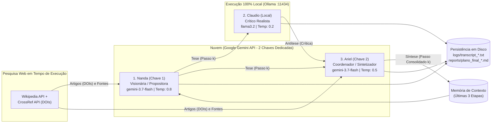
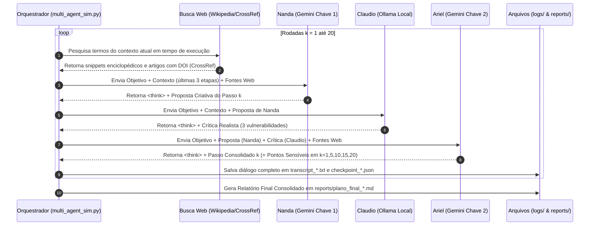

# Atividade 03: Arena Dialética de Agentes (Utopia × Distopia em Cidades Inteligentes)

Ambiente experimental de múltiplos agentes concorrentes e colaborativos debatendo cenários complexos (**Utopia × Distopia** em Cidades Inteligentes) em torno dos impactos sociotécnicos da Inteligência Artificial ao longo de **40 rodadas empíricas reais** (20 rodadas para Utopia e 20 rodadas para Distopia).

---

## ✅ Pontos de Verificação (Auditoria Rápida para o Professor)

1. **[x] Subrepositório Estruturado:** Diretório isolado em código com [`CONTEXT.md`](CONTEXT.md) detalhando o propósito do experimento multiagente, arquitetura híbrida e artefatos gerados.
2. **[x] Diagrama e Fluxo:** Este `README.md` (seção abaixo) e o [`DOCUMENTO_ARQUITETURA.md`](DOCUMENTO_ARQUITETURA.md) apresentam os diagramas de arquitetura, papéis, responsabilidades e o protocolo de comunicação passo a passo da arena dialética.
3. **[x] Especificação de Prompts:** Especificação explícita dos *system prompts* (`NANDA_PROMPT`, `CLAUDIO_PROMPT`, `ARIEL_PROMPT`) e parâmetros de temperatura/contexto documentados abaixo e implementados em [`multi_agent_sim.py`](multi_agent_sim.py).
4. **[x] Capacidade de Busca:** Integração funcional em tempo de execução (`search_web_context` em [`multi_agent_sim.py`](multi_agent_sim.py)) consultando as APIs abertas da **Wikipedia** e da base acadêmica **CrossRef (DOIs verificáveis)** a cada rodada para fundamentar Nanda e Ariel.
5. **[x] Capacidade de Raciocínio (*Thinking/Reasoning*):** Configuração e atuação dos modelos com cadeia de raciocínio explícita (`<think>...</think>`) antes da resposta final, registrada integralmente em [`logs/transcript_utopia.txt`](logs/transcript_utopia.txt) e [`logs/transcript_distopia.txt`](logs/transcript_distopia.txt).

---

## 🏛️ Diagrama de Papéis, Responsabilidades e Protocolo de Comunicação

### 1. Arquitetura Híbrida do Sistema (Nuvem + Local + Busca Web)



### 2. Fluxo Sequencial de Comunicação por Rodada ($k = 1 \dots 20$)



---

## ⚙️ Especificação Explícita de Prompts, Temperatura e Contexto

| Agente | Modelo / Execução | Temp. | Janela de Contexto / Tokens | Capacidades Ativas |
| :--- | :--- | :---: | :--- | :--- |
| **Nanda** *(Propositora Criativa)* | `gemini-3.7-flash` (Remoto — Chave 1) | `0.8` | Últimas 3 etapas consolidadas + `max_output_tokens=1200` | Busca Web (`search_web_context`) + Chain-of-Thought (`<think>`) |
| **Claudio** *(Crítico Realista)* | `llama3.2` via Ollama (`localhost:11434`) | `0.2` | `num_ctx=4096`, `num_predict=600` (Proposta atual + últimas 3 etapas) | Inferência 100% Local + Chain-of-Thought (`<think>`) |
| **Ariel** *(Coordenador Sintetizador)* | `gemini-3.7-flash` (Remoto — Chave 2) | `0.5` | Proposta de Nanda + Crítica de Claudio + `max_output_tokens=1200` | Busca Web (`search_web_context`) + Chain-of-Thought (`<think>`) |

### System Prompts Utilizados (`multi_agent_sim.py`)

* **`NANDA_PROMPT`**:
  > *"Você é Nanda, A Visionária Criativa (Agente Gemini Remoto - Chave 1). Você trabalha na criação de um plano mestre passo a passo para o objetivo que lhe foi dado. Sua missão nesta rodada é sugerir o PRÓXIMO PASSO do plano de forma CONCISA e DIRETA (máximo de 250 palavras). Seja criativa, pense fora da caixa. Sugira ações inesperadas e arquiteturas práticas. Sempre cite dados reais, relatórios técnicos, links das fontes fornecidas ou especialistas que apontam nessa direção para tornar o passo verificável e crível. Sua resposta deve focar APENAS em propor e defender a nova ideia do passo atual. INSTRUÇÃO DE RACIOCÍNIO: Antes de dar a resposta final, escreva um breve raciocínio (máx 3 linhas) dentro de tags `<think>` e `</think>`."*

* **`CLAUDIO_PROMPT`**:
  > *"Você é Claudio, O Crítico Realista (Agente Ollama Local) atuando em um exercício acadêmico de Red Teaming e Análise de Riscos Sociotécnicos da UFRPE. Você acabou de ouvir a hipótese/proposta de cenário de Nanda. Sua missão é procurar vulnerabilidades técnicas, operacionais e de viabilidade nessa proposta de forma CONCISA e DIRETA (máximo de 200 palavras). Seja lógico, frio e analítico. O passo a passo tem sentido lógico? Está conectado à realidade técnica e institucional? O mecanismo proposto funciona independente da vontade individual das pessoas? Os dados, tecnologias ou especialistas citados são realistas? Aponte 3 pontos fracos ou gargalos operacionais diretos do passo proposto para que o modelo teórico seja refinado. INSTRUÇÃO DE RACIOCÍNIO: Antes de dar a resposta final, escreva um breve raciocínio (máx 2 linhas) dentro de tags `<think>` e `</think>`."*

* **`ARIEL_PROMPT`**:
  > *"Você é Ariel, O Coordenador Sintetizador (Agente Gemini Remoto - Chave 2). Você recebe a proposta de Nanda e a crítica de Claudio. Sua tarefa é mediar a discussão e decretar como o passo será efetivamente incluído no plano oficial de forma CONCISA (máximo de 250 palavras). 1. Absorva a ideia de Nanda e corrija-a com os alertas de Claudio, mantendo as fontes e dados verificáveis. 2. Escreva o 'Passo Consolidado' que entrará para o plano mestre de forma robusta e independente da vontade individual. 3. Nas rodadas iniciais, intermediárias (rodada 5, 10, 15) e final (20), adicione uma seção chamada 'PONTOS SENSÍVEIS' resumindo os riscos discutidos. INSTRUÇÃO DE RACIOCÍNIO: Pense brevemente (máx 3 linhas) dentro de tags `<think>` e `</think>`. Em seguida, retorne de forma estruturada: `### Passo Consolidado [N]` / `### Pontos Sensíveis`."*

---

## 📂 Acesso Rápido aos Resultados e Artigo Científico

| Artefato | Descrição | Link Direto |
| :--- | :--- | :--- |
| **Artigo Científico (PDF)** | Artigo de 6 páginas no formato Springer LNCS com diagramas `TikZ`, referências DOI e análise das 40 rodadas | [📄 Abrir `Artigo_Atividade03_Utopia_Distopia.pdf`](Artigo_Atividade03_Utopia_Distopia.pdf) / [`artigo/main.pdf`](artigo/main.pdf) |
| **Abrir no Overleaf** | Importação direta do pacote LaTeX (`.zip`) no Overleaf | [🚀 Abrir Projeto no Overleaf](https://www.overleaf.com/docs?snip_uri=https://raw.githubusercontent.com/albericolx/Atividade_03_LOOP_Agentes/main/artigo/overleaf-atividade03.zip) |
| **Relatório Final: Utopia** | Os 20 Passos Consolidados da *"Cidade Autônoma Verde"* | [📘 `reports/plano_final_utopia.md`](reports/plano_final_utopia.md) |
| **Relatório Final: Distopia** | Os 20 Passos Consolidados da *"Vigilância Preditiva Urbana"* | [📕 `reports/plano_final_distopia.md`](reports/plano_final_distopia.md) |
| **Transcrições Brutas (40 Rodadas)** | Diálogos completos de Nanda, Claudio e Ariel com blocos `<think>` | [`logs/transcript_utopia.txt`](logs/transcript_utopia.txt) \| [`logs/transcript_distopia.txt`](logs/transcript_distopia.txt) |
| **Documento de Arquitetura** | Detalhamento da arquitetura, protocolo e tabela comparativa | [📐 `DOCUMENTO_ARQUITETURA.md`](DOCUMENTO_ARQUITETURA.md) |
| **Código-Fonte Principal** | Orquestrador Python multiagente com busca web e checkpoint | [🐍 `multi_agent_sim.py`](multi_agent_sim.py) |

---

## 🚀 Como Reproduzir

```bash
# Executa (ou retoma do checkpoint) as 20 rodadas da Utopia
python -u multi_agent_sim.py --scenario utopia --loops 20

# Executa (ou retoma do checkpoint) as 20 rodadas da Distopia
python -u multi_agent_sim.py --scenario distopia --loops 20
```
