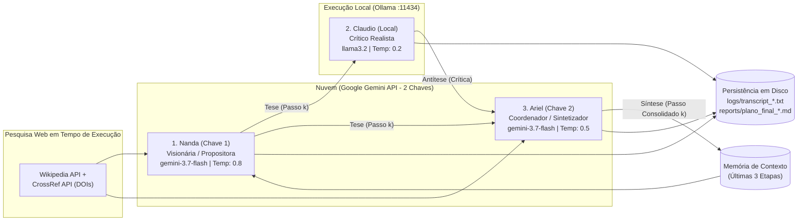

# Atividade 03: Arena Dialética de Agentes (Utopia × Distopia em Cidades Inteligentes)

Este subrepositório contém a implementação completa, os logs de transcrição bruta, os relatórios estratégicos consolidados e o artigo científico (formato Springer LNCS) do experimento de múltiplos agentes de IA interagindo em um loop dialético de 20 rodadas por cenário.

## Pontos de Verificação (Checklist de Entrega)

- [x] **1. Subrepositório Estruturado:** Diretório isolado com [`CONTEXT.md`](CONTEXT.md) detalhando o propósito e a arquitetura do experimento multiagente.
- [x] **2. Diagrama e Fluxo:** Este `README.md` e o [`DOCUMENTO_ARQUITETURA.md`](DOCUMENTO_ARQUITETURA.md) contêm os diagramas de papéis, responsabilidades e protocolo de comunicação passo a passo entre os agentes da arena dialética.
- [x] **3. Especificação de Prompts:** Especificação explícita dos prompts de sistema (`NANDA_PROMPT`, `CLAUDIO_PROMPT`, `ARIEL_PROMPT`) e parâmetros de temperatura/contexto em [`multi_agent_sim.py`](multi_agent_sim.py) (`Nanda=0.8`, `Claudio=0.2`, `Ariel=0.5`, janela deslizante das últimas 3 etapas consolidadas).
- [x] **4. Capacidade de Busca:** Integração funcional em tempo de execução (`search_web_context`) consultando APIs abertas da **Wikipedia** e da base científica **CrossRef (DOIs verificáveis)** para fundamentar Nanda e Ariel.
- [x] **5. Capacidade de Raciocínio (*Thinking/Reasoning*):** Configuração e atuação de todos os modelos com cadeia de raciocínio explícita (`<think>...</think>`) para reflexão crítica e argumentação antes da resposta final.

---

## Diagrama da Arquitetura e Protocolo de Comunicação



---

## Estrutura de Arquivos e Resultados Reais

1. **[`multi_agent_sim.py`](multi_agent_sim.py)**: Orquestrador Python da arena dialética (20 rodadas por cenário, suporte a *checkpoint* automático, busca web científica e separação de chaves de API).
2. **[`reports/plano_final_utopia.md`](reports/plano_final_utopia.md)**: Relatório final gerado após as **20 rodadas reais** do cenário **Utopia (*Cidade Autônoma Verde*)**.
3. **[`reports/plano_final_distopia.md`](reports/plano_final_distopia.md)**: Relatório final gerado após as **20 rodadas reais** do cenário **Distopia (*Vigilância Preditiva Urbana*)**.
4. **[`logs/transcript_utopia.txt`](logs/transcript_utopia.txt)** e **[`logs/transcript_distopia.txt`](logs/transcript_distopia.txt)**: Transcrições completas das 40 rodadas com as falas brutas e tags `<think>` de Nanda, Claudio e Ariel.
5. **[`DOCUMENTO_ARQUITETURA.md`](DOCUMENTO_ARQUITETURA.md)**: Documento detalhado da arquitetura, fluxo passo a passo e síntese analítica dos resultados.
6. **[`artigo/`](artigo/)**: Artigo científico em LaTeX no padrão **Springer LNCS** (`main.tex`, `main.pdf`, `references.bib` e pacote `overleaf-atividade03.zip` pronto para importação no Overleaf).

---

## Como Executar

```bash
# Executa (ou retoma do checkpoint) as 20 rodadas da Utopia
python -u multi_agent_sim.py --scenario utopia --loops 20

# Executa (ou retoma do checkpoint) as 20 rodadas da Distopia
python -u multi_agent_sim.py --scenario distopia --loops 20
```
